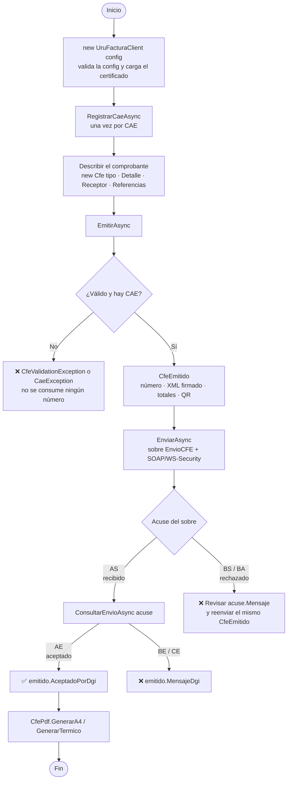
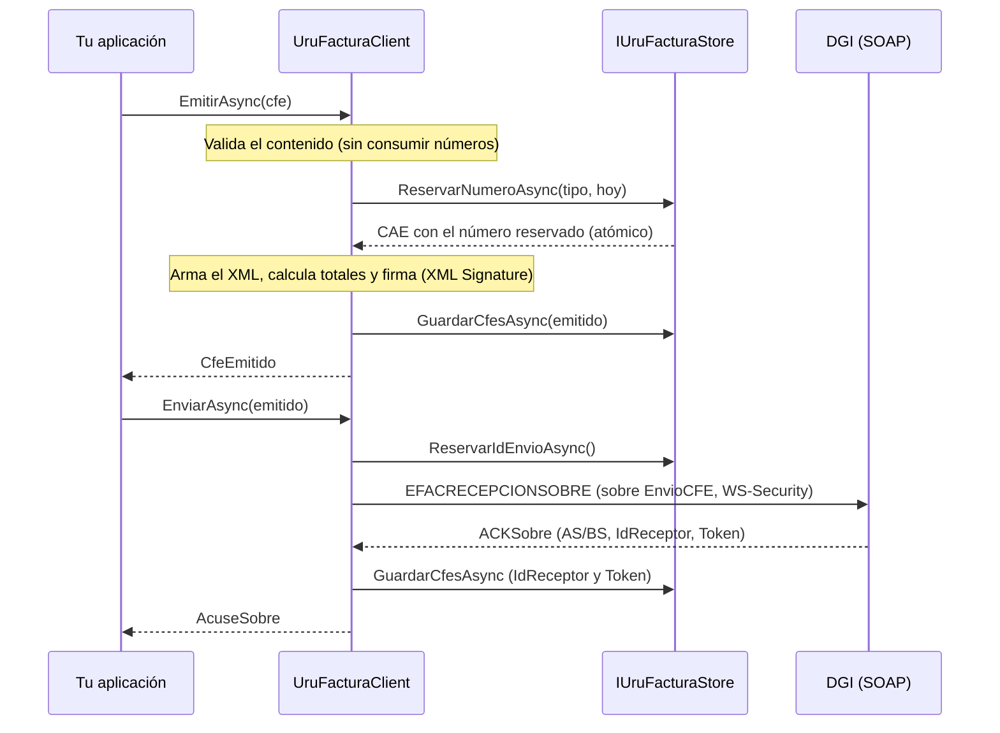
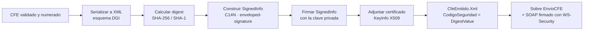
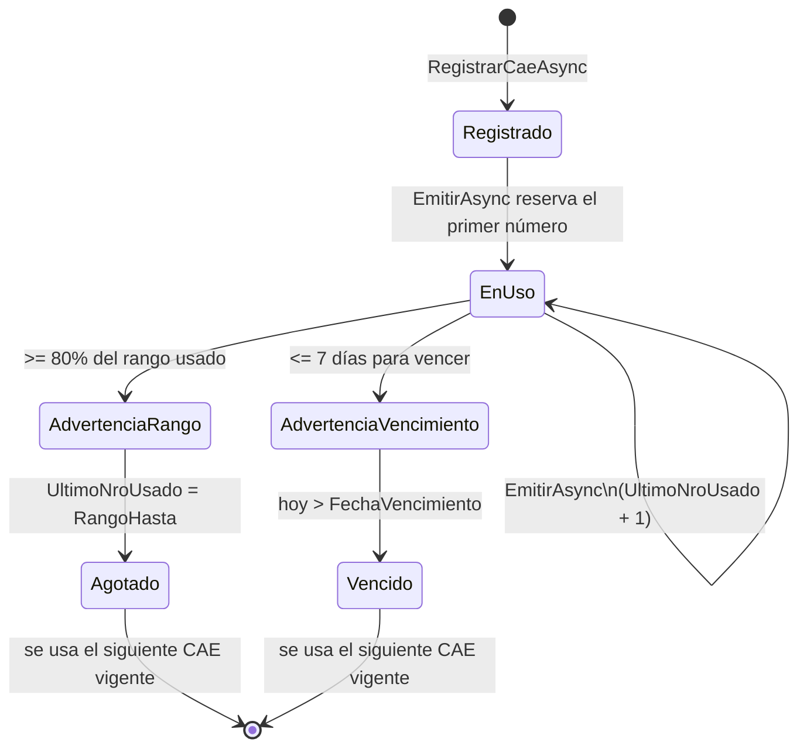
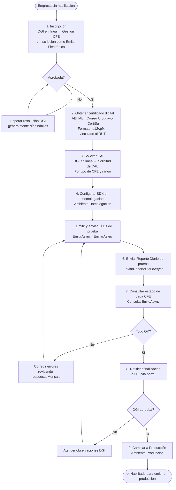
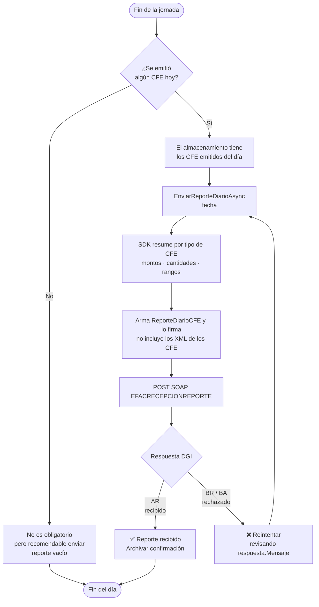
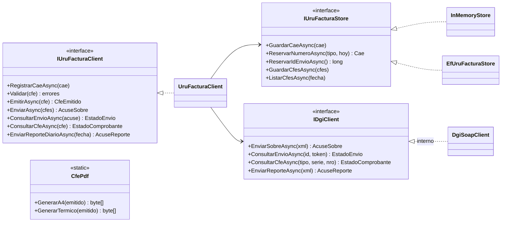

import { Aside } from '@astrojs/starlight/components';

Esta página reúne los flujos de trabajo principales en formato de diagrama para facilitar la comprensión del ciclo de vida completo de un comprobante fiscal electrónico.

---

## Flujo completo de emisión de un CFE

Desde la configuración inicial hasta obtener el PDF listo para entregar al cliente.

---

## Pipeline interno de EmitirAsync y EnviarAsync

---

## Flujo de firma digital

---

## Ciclo de vida de un CAE

<Aside type="tip">
  Monitoreá los CAE con `client.ObtenerAdvertenciasCaeAsync()` y registrá el siguiente antes de que el actual venza o se agote.
</Aside>

---

## Proceso de certificación DGI

Pasos necesarios para pasar de cero a emitir en producción.

---

## Flujo del Reporte Diario

DGI exige enviar un resumen de todos los CFE emitidos cada día.

<Aside type="caution">
  El Reporte Diario es **obligatorio** incluso si solo emitiste un CFE. No enviarlo puede generar infracciones ante DGI.
</Aside>

---

## Arquitectura de componentes

Las tres costuras públicas son el cliente, el almacenamiento y el transporte a la DGI. Todo lo demás (XML, firma, sobre, reporte) es interno.

